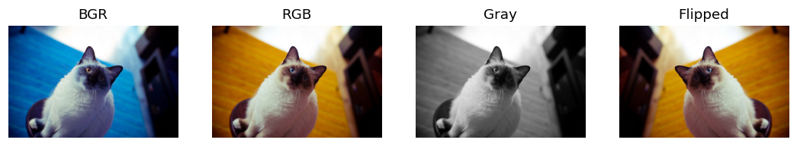
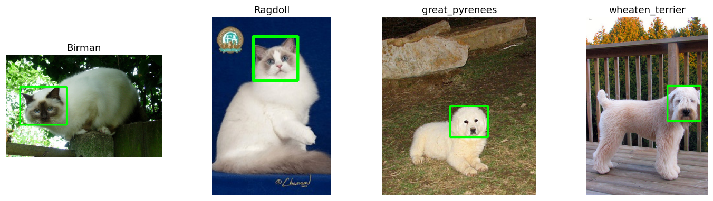

# Лабораторная 1: Окружение, репозиторий и анализ данных

**Вариант:** 19

## 1. Задача

Знакомство с окружением, структурой репозитория, исследование датасета, анализ форматов изображений и извлечение разметки боксов головы для пород кошек и собак.

## 2. Как запустить

Запускалось в среде Google Colab. Для воспроизведения результатов откройте `solution.ipynb`, укажите номер варианта и выполните все ячейки. 

```bash
pip install -r requirements.txt
# откройте solution.ipynb, впишите VARIANT и выполните Run All
```

## 3. Данные

Вариант 19. Датасет содержит 4 породы (кошки: Birman, Ragdoll; собаки: great_pyrenees, wheaten_terrier). Битовых или поврежденных файлов не обнаружено, все 100 изображений успешно прошли проверку.

## 4. Результаты

Что,Значение
Вариант,19
Всего файлов,100
Пород,4
Кошек / Собак,50 / 50
Ширина (мин / мед / макс),375 / 500 / 800
Высота (мин / мед / макс),375 / 500 / 768
Файлы не в RGB,0
Несоответствие расширения и формата,0
Файлов с XML-разметкой,100




## 5. Выводы

В датасете 19-го варианта ровно 100 изображений, все файлы имеют корректный формат JPEG и режим RGB (non_rgb = 0, fake_jpeg = 0).

Все 100 изображений обеспечены XML-разметкой боксов головы (n_with_xml = 100), что подтверждено визуализацией прямоугольников на сетке примеров.

Разрешение изображений варьируется от минимального 375×375 до максимального 800×768 пикселей при медианном размере 500 пикселей.

Набор данных включает 4 различные породы (Birman, Ragdoll, great_pyrenees, wheaten_terrier), по одной представительнице которых наглядно представлено на итоговой сетке samples_grid.png.
